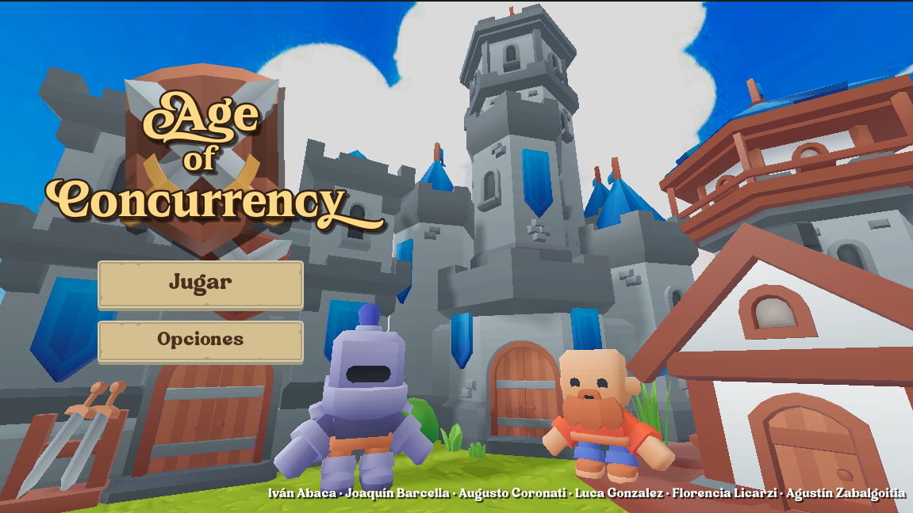

# Age of Concurrency

Juego de estrategia en tiempo real (RTS) multijugador **1 contra 1**, desarrollado como
**Trabajo Práctico Integrador** de la materia **Programación Concurrente**.

**Integrantes:** Iván Abaca · Joaquín Barcella · Augusto Coronati · Luca Gonzalez · Florencia Licarzi · Agustín Zabalgoitia

---

## 🎯 Finalidad

El objetivo del proyecto es **demostrar, medir y explicar** mecanismos de concurrencia,
sincronización y consistencia funcionando de forma coordinada en un juego real:

| Concepto de la materia | Cómo se demuestra en el juego |
|------------------------|-------------------------------|
| **Comunicación entre procesos** | Dos clientes Godot se comunican con un servidor C# por **TCP**, intercambiando mensajes JSON (uno por línea) |
| **Productor / consumidor** | Cada conexión lee sus comandos en forma concurrente y los deja en una **cola global**; un único consumidor (la simulación) los procesa en orden |
| **Paralelismo y barrera** | En cada tick, Economía y Combate se calculan **en paralelo** sobre el mismo snapshot inmutable; una **barrera** espera a ambos antes de confirmar los cambios |
| **Exclusión mutua y consistencia** | Solo la simulación escribe el estado del mundo; el resto trabaja sobre copias inmutables, así no hay condiciones de carrera |
| **Escritor único por conexión** | Cada cliente tiene su propia cola de salida con un solo escritor: un cliente lento no frena la partida ni al otro jugador |

---

## 🕹️ Descripción del juego

Dos jugadores compiten en el mismo mapa. Cada uno arranca con su **Centro Principal** y
algunos recursos, y tiene que hacer crecer su aldea para derrotar al rival:

- **Recolectar** madera de los árboles con los trabajadores.
- **Construir** granjas (comida), cuarteles, torres de defensa y cercas.
- **Entrenar** trabajadores y soldados.
- **Atacar** las unidades y edificios del rival.

### Reglas
- Exactamente **2 jugadores** por partida; la partida empieza cuando ambos están listos.
- Gana quien **destruya el Centro Principal rival**.
- Si los dos Centros Principales caen en el mismo instante, es **empate**.
- Si un jugador se desconecta, gana el que sigue conectado.

### Controles
| Acción | Control |
|--------|---------|
| Mover la cámara | `W` `A` `S` `D` (o arrastrar con la rueda presionada) |
| Mover la cámara más rápido | `Shift` |
| Acercar / alejar | Rueda del mouse |
| Girar la cámara | `Ctrl` + rueda del mouse |
| Seleccionar unidades | Clic izquierdo |
| Dar una orden (mover, recolectar, atacar, construir, reparar) | Clic derecho sobre el objetivo |
| Detener las unidades seleccionadas | `Q` |
| Construir granja / cuartel / torre / cerca | `1` / `2` / `3` / `4` |
| Pausa | `Esc` |

---

## 🧩 Arquitectura del software

El juego usa un modelo **cliente-servidor autoritativo**: el servidor es el único que decide
qué pasa en la partida, y los clientes solo envían órdenes y muestran el resultado.

```
   ┌──────────────┐                         ┌──────────────┐
   │ Cliente Godot│                         │ Cliente Godot│
   │  (Jugador 1) │                         │  (Jugador 2) │
   └──────┬───────┘                         └───────┬──────┘
          │            TCP + JSON por líneas        │
          └──────────────────┐   ┌──────────────────┘
                       ┌─────┴───┴─────┐
                       │  SERVIDOR C#  │  · Recibe y ordena los comandos
                       │ (autoritativo)│  · Simula la partida a 20 ticks/s
                       └───────────────┘  · Envía eventos y posiciones
```

El servidor se organiza en módulos, cada uno en su propio proyecto:

| Módulo | Responsabilidad |
|--------|-----------------|
| `Rts.Simulation` | Loop de 20 Hz, fases del tick, barrera y commit sobre el estado del mundo |
| `Rts.Economy` | Madera, comida, árboles y granjas |
| `Rts.Combat` | Ataques, daño y destrucciones |
| `Rts.Construction` | Colocación, construcción y reparación de edificios |
| `Rts.Movement` | Órdenes de movimiento, rutas y posiciones |
| `Rts.Production` | Colas de entrenamiento y aparición de unidades |
| `Rts.GameSession` | Conexión de jugadores y ciclo de vida de la partida |
| `Rts.Networking` | Sockets TCP, admisión de comandos, colas de salida y heartbeat |
| `Rts.StateSync` | Estado inicial, eventos y posiciones que se envían a cada cliente |
| `Rts.Shared` / `Rts.Protocol` | Tipos compartidos entre módulos / mensajes JSON |
| `Rts.Server` | Arma todas las piezas y corre la partida |

La documentación de diseño completa está en [`docs/`](docs/) (módulos, contratos y registro de decisiones).

---

## 💻 Tecnologías utilizadas

| Aspecto | Detalle |
|---------|---------|
| **Servidor** | C# sobre [.NET 10](https://dotnet.microsoft.com/download/dotnet/10.0) |
| **Cliente** | [Godot Engine 4.7](https://godotengine.org/) con GDScript, escena 3D |
| **Red** | TCP con mensajes JSON UTF-8 (uno por línea) |
| **Concurrencia** | `Task`s, `Channel`s y colas concurrentes de .NET; barrera entre fases; snapshots inmutables |
| **Pruebas** | xUnit (`dotnet test`): pruebas unitarias, de integración y de punta a punta por TCP |
| **Gráficos y audio** | Assets 3D, música y sonidos de uso libre |

---

## ⚙️ Requisitos

- **.NET SDK 10** ([descarga oficial](https://dotnet.microsoft.com/download/dotnet/10.0)) para el servidor.
- **Godot 4.7** ([descarga oficial](https://godotengine.org/download)) para el cliente — la versión estándar, no hace falta la de .NET.
- Windows, Linux o macOS de 64 bits. Desarrollado y probado principalmente en **Windows 11**.
- Para jugar en dos PCs: estar en la misma red (LAN) y tener el puerto **7777** habilitado en la PC del servidor.

---

## 🚀 Cómo ejecutar

### 1. Levantar el servidor

Desde la carpeta `TP-Integrador/server`:

```bash
# Crear la configuración a partir del ejemplo (solo la primera vez)
cp config/server.example.json config/server.json

# Correr el servidor
dotnet run --project src/Rts.Server -- --config config/server.json
```

El servidor queda escuchando en el puerto **7777** y espera a los dos jugadores.
Opciones útiles: `--port <puerto>` para usar otro puerto y `--validate-only` para solo
verificar la configuración y el mapa.

### 2. Abrir los dos clientes

1. Abrir Godot 4.7 → **Importar** → seleccionar `TP-Integrador/client/project.godot`.
2. Ejecutar con **F5**. Para probar en una sola PC, en *Depurar → Personalizar instancias
   de ejecución* se pueden lanzar **2 instancias** a la vez.
3. En cada ventana: **Jugar** → completar la dirección del servidor (en la misma PC:
   `127.0.0.1`, puerto `7777`) → **Conectar**.
4. Cuando los dos jugadores están conectados y listos, la partida empieza.

### 3. Correr las pruebas (opcional)

Desde `TP-Integrador/server`:

```bash
dotnet test Rts.slnx
```

Para comparar el tick paralelo contra el secuencial (los resultados quedan en
[`docs/measurements/`](docs/measurements/)):

```bash
dotnet run -c Release --project tools/Rts.Measurement
```
